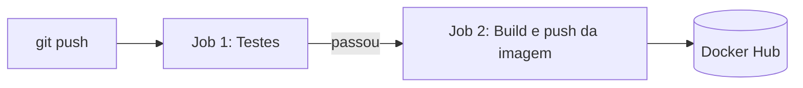

# TaskList

[](https://github.com/gustadev06/TaskList/actions/workflows/tasklist.yml)
[](https://hub.docker.com/r/gustavin06/tasklist-api)

Gerenciador de tarefas com **API REST em Node.js/Express**, **frontend em React (Vite)**, **testes automatizados**, **Docker** e **pipeline de CI** no GitHub Actions que publica a imagem no Docker Hub.

## Sumário

- [Sobre o projeto](#sobre-o-projeto)
- [Passo a passo](#passo-a-passo)
  1. [Pré-requisitos](#1-pré-requisitos)
  2. [Baixar e instalar](#2-baixar-e-instalar)
  3. [Rodar a API](#3-rodar-a-api)
  4. [Rodar o frontend](#4-rodar-o-frontend)
  5. [Testar a API](#5-testar-a-api)
  6. [Rodar os testes automatizados](#6-rodar-os-testes-automatizados)
  7. [Docker](#7-docker)
  8. [Pipeline de CI](#8-pipeline-de-ci-github-actions)
  9. [Versão de produção do frontend (opcional)](#9-versão-de-produção-do-frontend-opcional)
- [Terminais durante o uso](#terminais-durante-o-uso)
- [Problemas comuns](#problemas-comuns)

---

## Sobre o projeto

### Objetivo

O TaskList permite **criar, listar, editar, concluir e excluir tarefas**. A solução tem uma API REST em Node.js/Express e uma interface web em React. A API é empacotada numa imagem Docker, e um pipeline de CI testa o código e, só se todos os testes passarem, publica a imagem no Docker Hub.

### Escopo

| Dentro do escopo | Fora do escopo |
| --- | --- |
| CRUD de tarefas pela API REST | Login e cadastro de usuários |
| Validação dos dados (título obrigatório, até 200 caracteres) | Banco de dados |
| Persistência das tarefas em arquivo JSON | Deploy em servidor ou nuvem |
| Frontend web integrado à API | Categorias, prazos ou prioridades |
| Testes automatizados (unitários e de integração) | |
| Containerização da API com Docker | |
| Pipeline de CI com publicação no Docker Hub | |

### Tecnologias

| Camada | Tecnologia |
| --- | --- |
| API | Node.js 22 + Express 5 |
| Frontend | React + Vite + Tailwind |
| Testes | `node:test` (nativo do Node, sem biblioteca extra) |
| Container | Docker (`node:22-alpine`) |
| CI | GitHub Actions |
| Registry | Docker Hub |

### Estrutura

```
TaskList/
├── src/server.js                  → API Express (porta 3000)
├── tests/
│   ├── validacao.test.js          → testes unitários
│   └── api.test.js                → testes de integração
├── frontend/                      → interface React + Vite (porta 5173)
├── data/tasks.json                → onde as tarefas ficam salvas (criado automaticamente)
├── Dockerfile                     → receita da imagem da API
├── .dockerignore                  → o que NÃO entra na imagem
└── .github/workflows/tasklist.yml → pipeline de CI
```

---

## Passo a passo

### 1. Pré-requisitos

- [Node.js](https://nodejs.org) 20 ou maior → confira com `node -v`
- pnpm (para o frontend) → `npm install -g pnpm`
- [Docker Desktop](https://www.docker.com/products/docker-desktop/) (para a parte de Docker)
- Git

### 2. Baixar e instalar

```bash
git clone https://github.com/gustadev06/TaskList.git
cd TaskList
npm run setup
```

O `npm run setup` instala as dependências da API e do frontend. Só precisa rodar na primeira vez.

### 3. Rodar a API

No **terminal 1**:

```bash
npm start
```

Deve aparecer `Servidor rodando na porta 3000`. Teste abrindo http://localhost:3000 no navegador (aparece `API no ar!`).

> Durante o desenvolvimento, `npm run dev` reinicia a API sozinho quando você salva o arquivo.

### 4. Rodar o frontend

Com a API rodando, abra **outro terminal** (botão **+** no painel do terminal do VS Code):

```bash
npm run front
```

Abra http://localhost:5173 e teste: criar, concluir e excluir uma tarefa.

> Se a API estiver em outro endereço, altere em **Configurações → URL da API** dentro do app.

### 5. Testar a API

#### Rotas

| Método | Rota | Descrição |
| --- | --- | --- |
| GET | `/` | Verifica se a API está no ar |
| GET | `/tasks` | Lista as tarefas |
| GET | `/tasks/:id` | Busca uma tarefa |
| POST | `/tasks` | Cria tarefa — body: `{ "title": "..." }` |
| PATCH | `/tasks/:id` | Edita a tarefa — body: `{ "title": "...", "done": true/false }` |
| PATCH | `/tasks/:id/complete` | Marca a tarefa como concluída |
| DELETE | `/tasks/:id` | Exclui a tarefa (responde `204`, sem corpo) |

O `title` precisa ser um texto não vazio de até 200 caracteres. Os erros sempre voltam em JSON no formato `{ "error": "mensagem" }`, com status `400` (dado inválido) ou `404` (não encontrado).

#### Pelo navegador (só GET)

- http://localhost:3000 → `API no ar!`
- http://localhost:3000/tasks → lista as tarefas em JSON

#### Pelo PowerShell

Rode as duas primeiras linhas antes, elas guardam o endereço da API e o tipo do conteúdo. Troque o `1` pelo id da tarefa.

```powershell
$api = "http://localhost:3000"
$json = "application/json"

# Verificar se a API está no ar
Invoke-RestMethod "$api/"

# Criar uma tarefa
Invoke-RestMethod "$api/tasks" -Method Post -ContentType $json -Body '{"title":"Estudar Docker"}'

# Listar as tarefas
Invoke-RestMethod "$api/tasks"

# Buscar uma tarefa
Invoke-RestMethod "$api/tasks/1"

# Editar o título
Invoke-RestMethod "$api/tasks/1" -Method Patch -ContentType $json -Body '{"title":"Estudar CI"}'

# Marcar como concluída
Invoke-RestMethod "$api/tasks/1/complete" -Method Patch

# Excluir (não mostra nada: a API responde 204, sem corpo)
Invoke-RestMethod "$api/tasks/1" -Method Delete
```

Para mostrar a **validação** (título vazio → erro 400) sem o bloco vermelho do PowerShell:

```powershell
try { Invoke-RestMethod "$api/tasks" -Method Post -ContentType $json -Body '{"title":""}' } catch { "Status: " + $_.Exception.Response.StatusCode.value__; $_.ErrorDetails.Message }
```

Resultado esperado:

```
Status: 400
{"error":"title é obrigatório e deve ser um texto"}
```

#### Pelo Postman (opcional)

1. **GET** `http://localhost:3000/tasks` → **Send**
2. Para criar: **POST** na mesma URL, aba **Body → raw → JSON**, enviando `{"title":"Estudar Docker"}`
3. Para concluir: **PATCH** `http://localhost:3000/tasks/1/complete`
4. Para excluir: **DELETE** `http://localhost:3000/tasks/1`

#### Variáveis de ambiente

| Variável | Padrão | Descrição |
| --- | --- | --- |
| `PORT` | `3000` | Porta da API |
| `DATA_FILE` | `data/tasks.json` | Arquivo onde as tarefas são salvas |

### 6. Rodar os testes automatizados

```bash
npm test
```

Resultado esperado no final: `tests 21`, `pass 21`, `fail 0`.

Os testes usam o test runner nativo do Node (`node:test`). Eles sobem a API numa porta livre e usam um arquivo temporário, então podem rodar com a API ligada e não mexem no `data/tasks.json`.

| Tipo | Arquivo | Qtd. | O que testa |
| --- | --- | --- | --- |
| Unitário | `tests/validacao.test.js` | 6 | A função `validateTitle` isolada (título válido, vazio, só espaços, não-texto, limite de 200 caracteres) |
| Integração | `tests/api.test.js` | 15 | Sobe a API e testa todas as rotas via HTTP: sucesso, erros 400 e 404, JSON inválido e gravação no arquivo |

**Onde ver os testes:**

- **Código**: pasta `tests/` no VS Code. Cada `test('...')` é um teste, e o texto diz o que ele verifica.
- **Rodando no CI**: [aba Actions](https://github.com/gustadev06/TaskList/actions) → último run → job **Testes** → passo **Rodar os testes**.

### 7. Docker

> Abra o **Docker Desktop** antes e espere ficar "running".
> Só pode ter **uma API por vez** na porta 3000: ou o `npm start`, ou um dos containers abaixo.

#### Buildar a imagem

```bash
docker build -t tasklist-api .
```

No final deve aparecer `naming to docker.io/library/tasklist-api:latest`.

#### Rodar a API no container (escolha UMA das opções)

```bash
# Opção A: imagem que você buildou no seu PC
docker run --rm --init -p 3000:3000 tasklist-api

# Opção B: imagem publicada no Docker Hub pelo CI (baixa se não tiver)
docker run --rm --init -p 3000:3000 gustavin06/tasklist-api:latest
```

Deve aparecer `Servidor rodando na porta 3000`. O terminal fica preso enquanto o container roda. Para parar, aperte **Ctrl + C**.

| Parte do comando | O que faz |
| --- | --- |
| `--rm` | Apaga o container quando ele para |
| `--init` | Faz o **Ctrl + C** parar o container de verdade |
| `-p 3000:3000` | Liga a porta 3000 do computador à porta 3000 do container |

> As tarefas criadas no container somem quando ele para, porque o `data/` não vai para a imagem (está no `.dockerignore`).

#### Rodar em segundo plano (libera o terminal)

```bash
docker run -d --rm --init -p 3000:3000 --name tasklist gustavin06/tasklist-api:latest
docker logs tasklist     # ver os logs
docker stop tasklist     # parar
```

#### Ver imagens e containers

```bash
# Imagens no computador
docker images

# Containers rodando
docker ps

# Camadas da imagem (cada instrução do Dockerfile vira uma camada)
docker history gustavin06/tasklist-api:latest

# Abrir um terminal DENTRO do container rodando (depois: ls, e exit para sair)
docker exec -it $(docker ps -q --filter publish=3000) sh

# Parar qualquer container que esteja usando a porta 3000
docker stop $(docker ps -q --filter publish=3000)
```

No **Docker Desktop** dá para ver tudo visualmente: **Images** (as imagens, com as camadas ao clicar) e **Containers** (o container rodando e os logs).

#### O que o Dockerfile faz

| Instrução | O que faz |
| --- | --- |
| `FROM node:22-alpine` | Usa como base um Linux leve (Alpine) já com Node 22 |
| `WORKDIR /app` | Define a pasta de trabalho dentro do container |
| `COPY package*.json ./` | Copia só os arquivos de dependência primeiro, para aproveitar o cache |
| `RUN npm ci --omit=dev` | Instala as dependências de produção (express e cors) |
| `COPY src ./src` | Copia o código da API |
| `EXPOSE 3000` | Documenta que a API usa a porta 3000 |
| `CMD ["node", "src/server.js"]` | Comando que sobe a API quando o container inicia |

### 8. Pipeline de CI (GitHub Actions)

Arquivo: `.github/workflows/tasklist.yml`



1. **Testes**: instala as dependências (`npm ci`) e roda `npm test`
2. **Build e publicação no Docker Hub**: só roda se os testes passarem (`needs: test`). Builda a imagem e publica com duas tags:
   - `latest` → sempre a versão mais nova
   - o hash do commit → identifica exatamente qual código gerou a imagem

**Quando roda:**

| Evento | O que acontece |
| --- | --- |
| Push na `main` ou `develop` | Testes + build + publicação |
| Pull request para a `main` | Só os testes |
| Botão **Run workflow** na aba Actions | Testes + build + publicação (manual) |

#### Configuração (só uma vez)

**No Docker Hub:**

1. Entre em https://hub.docker.com
2. Foto de perfil → **Account settings** → **Personal access tokens** → **Generate new token**
3. Description `github-actions`, permissão **Read & Write** → **Generate**
4. Copie o token que começa com `dckr_pat_` (ele só aparece uma vez)

**No GitHub** (repositório → **Settings** → **Secrets and variables** → **Actions**):

| Aba | Nome | Valor |
| --- | --- | --- |
| Variables | `DOCKERHUB_USERNAME` | Usuário do Docker Hub (ex.: `gustavin06`) |
| Secrets | `DOCKERHUB_TOKEN` | O token `dckr_pat_...` |

> O token fica num **secret**: não aparece no código nem nos logs.

#### Disparar e acompanhar

```bash
git add .
git commit -m "mensagem do commit"
git push
```

1. Abra a [aba Actions](https://github.com/gustadev06/TaskList/actions) e clique no run do **CI - TaskList**
2. Veja os dois jobs: **Testes** → **Build e publicação no Docker Hub**
3. Confira a imagem nas [tags do Docker Hub](https://hub.docker.com/r/gustavin06/tasklist-api/tags): `latest` e o hash do commit

Se algum teste falhar, o job de testes fica vermelho e **nenhuma imagem é publicada**.

### 9. Versão de produção do frontend (opcional)

```bash
cd frontend
pnpm build
node dist/index.js
```

Abra http://localhost:4173 (a API precisa continuar rodando na 3000).

---

## Terminais durante o uso

| Terminal | Comando | Observação |
| --- | --- | --- |
| 1 | `npm start` **ou** `docker run ...` | API, fica rodando |
| 2 | `npm run front` | Frontend, fica rodando |
| 3 | `npm test`, PowerShell, `docker ps`, `docker images` | Comandos rápidos |

---

## Problemas comuns

| Problema | Solução |
| --- | --- |
| `port is already allocated` ao rodar o container | Já tem um container na porta 3000. Pare com `docker stop $(docker ps -q --filter publish=3000)` |
| `A porta 3000 já está em uso` ao rodar `npm start` | Um container ou outra API já está na 3000. Pare o outro antes (Ctrl + C ou `docker stop`) |
| **Ctrl + C** não para o container | Rode o container com `--init`. Se já estiver rodando sem ele, use o `docker stop` acima |
| `error during connect` no Docker | O Docker Desktop não está aberto. Abra e espere ficar "running" |
| Frontend abre mas não carrega as tarefas | A API não está rodando. Confira o terminal 1 e teste http://localhost:3000 |
| `pnpm` não é reconhecido | `npm install -g pnpm` e abra um terminal novo |
| `Unknown command: "teste"` | O comando é `npm test` (sem o "e") |
| Erro vermelho ao criar tarefa com título vazio | É o esperado: a validação recusou o dado com erro 400 |
